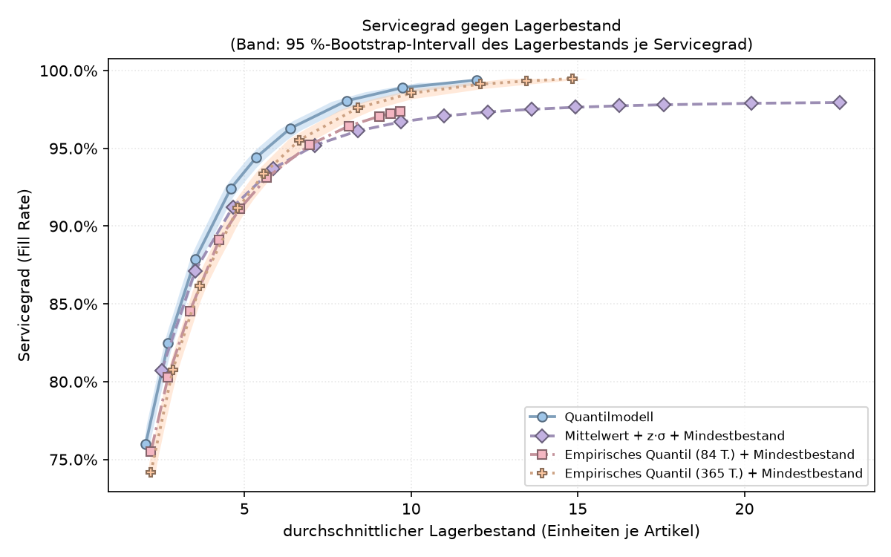
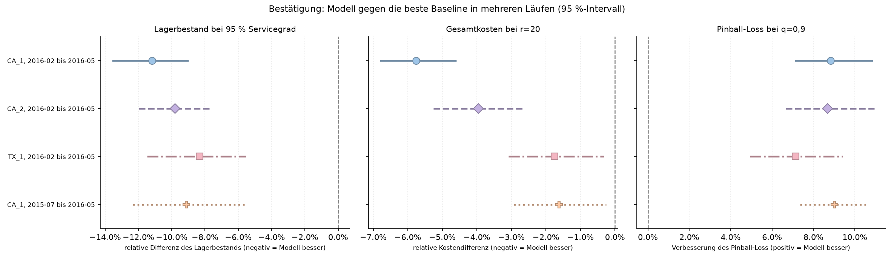

# Nachfrageprognose und Bestandsoptimierung (M5)

[](https://github.com/mweyrauch/DemandForecasting/actions/workflows/ci.yml)

Wie viel Lagerbestand spart eine probabilistische Nachfrageprognose gegenüber einfachen,
sorgfältig abgestimmten Bestellregeln? Dieses Projekt beantwortet die Frage auf den
M5-Verkaufsdaten von Walmart mit Quantilmodellen (LightGBM) und einer Bestandssimulation.

## Kernergebnis

Bei 95 % Servicegrad benötigt das Quantilmodell etwa 8 bis 11 % weniger Lagerbestand als die
beste von fünf Baselines. Im Hauptlauf (Filiale CA_1, Februar bis Mai 2016) sind es 11,2 %
(95-%-Intervall: 9,0 bis 13,6 %). Auf zwei weiteren Filialen und über zehn Monate bleibt der
Vorsprung bei 8,3 bis 9,8 %.



## Ergebnisse

Relative Differenz des Modells zur jeweils besten Baseline, mit 95-%-Bootstrap-Intervall über die
Artikel. Negative Werte bedeuten, dass das Modell weniger Lager bzw. geringere Kosten braucht.

| Kennzahl (Hauptlauf CA_1) | Modell gegen beste Baseline |
|---|---|
| Lagerbestand bei 90 % Servicegrad | −6,7 % [−8,3 %, −5,0 %] |
| Lagerbestand bei 95 % Servicegrad | −11,2 % [−13,6 %, −9,0 %] |
| Lagerbestand bei 98 % Servicegrad | −11,8 % [−14,2 %, −8,1 %] |
| Gesamtkosten, Kostenverhältnis 5 bis 100 | −1,3 % bis −8,6 % |
| Pinball-Loss der Bedarfssumme, q = 0,5 bis 0,975 | 5 bis 9 % besser |

Bestätigung ohne weitere Anpassung des Modells:

| Lauf | Lagerbestand bei 95 % | Gesamtkosten (r = 20) | Pinball-Loss (q = 0,9) |
|---|---|---|---|
| CA_1, Feb. bis Mai 2016 (Hauptlauf) | −11,2 % [−13,6 %, −9,0 %] | −5,8 % [−6,8 %, −4,6 %] | +8,8 % [+7,1 %, +10,9 %] |
| CA_2, Feb. bis Mai 2016 | −9,8 % [−12,0 %, −7,7 %] | −4,0 % [−5,3 %, −2,6 %] | +8,7 % [+6,7 %, +10,9 %] |
| TX_1, Feb. bis Mai 2016 | −8,3 % [−11,5 %, −5,6 %] | −1,7 % [−3,1 %, −0,3 %] | +7,1 % [+4,9 %, +9,4 %] |
| CA_1, Juli 2015 bis Mai 2016 | −9,1 % [−12,3 %, −5,5 %] | −1,6 % [−2,9 %, −0,3 %] | +9,0 % [+7,4 %, +10,6 %] |



Die vollständigen Tabellen liegen unter [`docs/results/`](docs/results/).

## Vorgehen

1. **Merkmale ohne Leakage:** Lags, gleitende Durchschnitte und Langfristmerkmale (91 bis
   364 Tage) sind um den Prognosehorizont von 28 Tagen verschoben. Dazu kommen Preis und Kalender.
2. **Quantilmodelle:** LightGBM sagt Quantile der Bedarfssumme über Lieferzeit plus einen Tag
   voraus. Daraus ergibt sich direkt der Zielbestand.
3. **Baselines:** Mittelwert plus z mal Standardabweichung sowie empirische Quantile über 84 und
   365 Tage, jeweils auch mit Mindestbestand. Verglichen wird immer mit der besten Baseline.
4. **Bestandssimulation:** Order-up-to-Politik mit drei Tagen Lieferzeit. Ausgewertet werden
   Lagerbestand bei festem Servicegrad und Gesamtkosten.
5. **Validierung:** drei rollierende 28-Tage-Fenster, Neutraining je Fenster,
   Bootstrap-Intervalle über die Artikel.

Details, Kennzahlen-Glossar und alle Abbildungen: [`docs/methodik.md`](docs/methodik.md).

## Grenzen

- Die Intervalle erfassen die Unsicherheit der Artikelauswahl, nicht die zeitliche Schwankung.
- Die Langfristmerkmale wurden auf den Testfenstern des Hauptlaufs entwickelt. Der Hauptlauf ist
  deshalb vermutlich die optimistischste Schätzung, die Bestätigungsläufe sind realistischer.
- Die Bestätigungsläufe sind nicht vollständig unabhängig: gleiches Sortiment, teils gleicher
  Zeitraum, ein Datensatz.
- Die Simulation ist vereinfacht: tägliche Bestellung, feste Lieferzeit, nicht gedeckte Nachfrage
  geht verloren, keine Bestellkosten.

## Schnellstart

```bash
pip install -e ".[dev,kaggle]"
python scripts/train_forecast.py        # Hauptlauf, schreibt nach results/
python scripts/run_confirmation.py      # Bestätigungsläufe und Zusammenfassung
pytest
```

Die Daten werden per `kagglehub` geladen und sind nicht Teil des Repositories. Voraussetzungen und
Nutzungsbedingungen stehen in [`data/README.md`](data/README.md). Ein Test ohne echte Daten:

```bash
python scripts/make_synthetic_m5.py --out data/synthetic
python scripts/train_forecast.py --config configs/synthetic.yaml
```

## Aufbau

| Pfad | Inhalt |
|---|---|
| `src/dfi/` | Daten, Merkmale, Modelle, Bestandssimulation, Bootstrap, Abbildungen |
| `scripts/` | Hauptlauf, Bestätigungsläufe, Zusammenfassung, synthetische Testdaten |
| `configs/` | Konfiguration für Hauptlauf, Test und Bestätigungsläufe |
| `tests/` | Unit-Tests |
| `docs/` | Methodik, Abbildungen und Ergebnistabellen |
