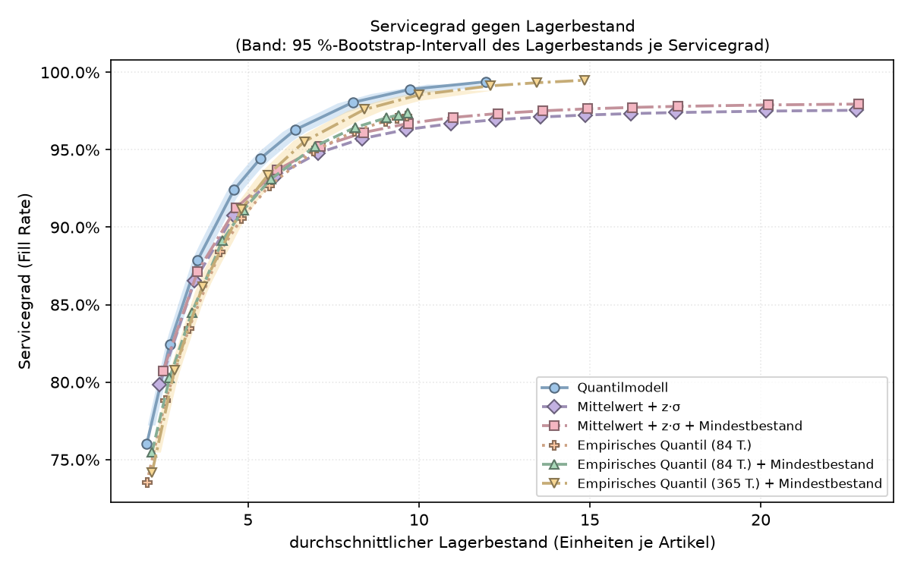

# Nachfrageprognose und Bestandsoptimierung (M5)

> **Status: in Arbeit.** Pipeline und Auswertung laufen, die Ergebnisse unten sind noch auszufuellen.

## Fragestellung

Wie stark verbessern probabilistische Nachfrageprognosen (Quantil-Modelle) Servicegrad und
Lagerbestand gegenueber einfachen Durchschnittsprognosen?

## Kernergebnis

Ueber drei direkt aufeinanderfolgende 28-Tage-Fenster (84 Tage, eine Jahreszeit) benoetigte das
Quantilmodell mit Langfristmerkmalen bei 95 % Servicegrad rund 11 % weniger Lagerbestand als die
beste von fuenf Baselines (empirisches Quantil mit 365 Tagen Rueckblick und Mindestbestand;
95-%-Intervall: 9 bis 14 %). Bei 90 % Servicegrad sind es rund 6 % weniger, bei 98 % rund 12 %. Bei den
Gesamtkosten liegt das Modell je nach Kostenverhaeltnis 1 bis 9 % unter der besten Baseline. Beim
Pinball-Loss der Bedarfssumme ist es bei allen Quantilen besser. Ohne die Langfristmerkmale war der
Unterschied zur besten Baseline nicht erkennbar. Die Intervalle erfassen die Unsicherheit der
Artikelauswahl, nicht die zeitliche Schwankung. Die Langfristmerkmale wurden eingefuehrt, nachdem die
Ergebnisse auf denselben Testfenstern bekannt waren; eine Bestaetigung auf unabhaengigen Zeitraeumen
oder Filialen steht aus (siehe "Annahmen und Grenzen").

_Stand: Standardkonfiguration (alle 3.049 Artikel einer Filiale), 3 rollierende Splits._



## Daten

[M5 Forecasting (Walmart)](https://www.kaggle.com/c/m5-forecasting-accuracy), taegliche
Verkaufszahlen mit Preisen und Kalender. Die Daten sind **nicht** Teil des Repositories und werden per `kagglehub` geladen
(siehe [`data/README.md`](data/README.md)). Nutzungsbedingungen des Wettbewerbs beachten.

## Wichtige Kennzahlen

| Begriff | Bedeutung |
|---|---|
| **Lieferzeit** | Tage zwischen Bestellung und Wareneingang (Annahme: 3 Tage). |
| **Bedarfssumme** | Summe der Nachfrage ueber *Lieferzeit + 1* Tage ab heute. Der Bestand muss reichen, bis die naechste Bestellung eintrifft. Das Quantilmodell sagt genau diese Groesse voraus. |
| **Zielbestand (Order-up-to-Niveau)** | Soll-Bestand inklusive bereits bestellter Ware. Bestellmenge = Zielbestand minus (Lagerbestand + Ware unterwegs). Der Zielbestand ist ein Quantil der Bedarfssumme. |
| **Quantil q** | "Mit Wahrscheinlichkeit q ist die Bedarfssumme hoechstens so gross." Ein hoeheres q bedeutet mehr Sicherheit und mehr Lager. |
| **Kalibrierung** | Anteil der Faelle, in denen die Nachfrage tatsaechlich unter dem vorhergesagten Quantil lag. Sollte ungefaehr q entsprechen. |
| **Servicegrad (Fill Rate)** | 1 minus entgangene Menge geteilt durch Gesamtnachfrage, mengengewichtet ueber alle Artikel. Nicht zu verwechseln mit q: q ist die Wahrscheinlichkeit, keine Fehlmenge zu haben, der Servicegrad der Anteil gelieferter Einheiten. |
| **Durchschnittlicher Lagerbestand** | Mittlerer Bestand am Tagesende in Einheiten je Artikel. Naeherung fuer die Kapitalbindung. |
| **Fehlmenge (Lost Sales)** | Nachfrage, die nicht bedient werden konnte. Sie geht verloren und wird nicht nachgeliefert. |
| **Kostenverhaeltnis r** | Kosten einer fehlenden Einheit relativ zu den Lagerkosten einer Einheit pro Tag. Gesamtkosten = Lager-Einheitentage + r mal Fehlmenge. |
| **WAPE** | Summe der absoluten Fehler geteilt durch die Summe der tatsaechlichen Verkaeufe. |
| **MASE** | Fehler im Verhaeltnis zum Fehler einer naiven Prognose (unter 1 ist besser als naiv). |
| **Merkmalswichtigkeit (Gain)** | Anteil, den ein Merkmal am gesamten Verbesserungsgewinn aller Baumsplits hat (Summe 100 %). Zeigt, welche Merkmale das Modell nutzt, aber keine Kausalitaet; korrelierte Merkmale teilen sich die Wichtigkeit. Kennungen (Artikel, Filiale, Abteilung) sind als Zahlen codiert, das kann ihre Wichtigkeit verzerren. |
| **Mindestbestand** | Untergrenze fuer das Zielniveau (hier 1 Einheit). Verhindert, dass Artikel ohne juengere Verkaeufe dauerhaft kein Lager haben. |
| **Beste Baseline** | Die Baseline-Variante mit dem niedrigsten Lagerbestand (bzw. den niedrigsten Kosten) bei dem jeweiligen Ziel. Sie wird anhand derselben Testdaten gewaehlt. |
| **Pinball-Loss** | Verlustfunktion fuer Quantilprognosen: bestraft zu niedrige und zu hohe Werte asymmetrisch je nach q. Wird zum Trainieren und zum Vergleich der Quantilprognosen genutzt. |
| **Bootstrap-Konfidenzintervall** | Die Artikel werden mit Zuruecklegen neu gezogen und die Kennzahl jeweils neu berechnet. Die mittleren 95 % der Ergebnisse bilden das Intervall. Es zeigt, wie stark ein Ergebnis von der Artikelauswahl abhaengt. |

## Methode

1. **Baselines:** Seasonal Naive und gleitender Durchschnitt (`dfi/baselines.py`).
2. **Features ohne Leakage:** Alle Lags und Rolling-Statistiken sind um mindestens den
   Prognosehorizont (28 Tage) verschoben (`dfi/features.py`). Dadurch ist keine rekursive
   Prognose noetig, und jedes Feature ist zum Prognosezeitpunkt bekannt. Neben Lags und kurzen
   Durchschnitten (7 und 28 Tage) gibt es Langfristmerkmale ueber 91, 182 und 364 Tage
   (Durchschnitt, Anteil der Tage ohne Verkauf, Streuung; Konfiguration `forecast.long_windows`),
   die dem Modell dieselbe lange Historie geben wie die 365-Tage-Baseline.
3. **Quantil-Modelle:** Gradient Boosting (LightGBM) fuer mehrere Quantile, nicht kreuzend
   (`dfi/models.py`).
4. **Validierung:** zeitlich getrennt mit rollierenden Cutoffs (standardmaessig 3 Fenster zu je
   28 Tagen), sowohl fuer die Baselines als auch fuer die Quantil-Modelle. Metriken: WAPE, MASE,
   Pinball-Loss und Kalibrierung (`dfi/evaluate.py`). Der Pinball-Loss steuert das Training der
   Quantilmodelle und vergleicht ausserdem das Modell fuer die Bedarfssumme mit der empirischen
   Baseline auf denselben Quantilen.
5. **Bestandssimulation:** Order-up-to-Politik mit Lieferzeit (`dfi/inventory.py`). Verglichen werden
   (Konfiguration unter `inventory.baselines`):
   - `quantile_model_window`: Quantilmodell, das die Bedarfssumme ueber Lieferzeit + 1 Tage direkt
     vorhersagt. Das Trainingsfenster endet so, dass kein Zielfenster in den Testzeitraum reicht
     (kein Leakage). Zusaetzlich eine Variante mit Mindestbestand (`_floor`).
   - `baseline_mean_z`: Mittelwert der letzten 28 Tage plus z mal Standardabweichung.
   - `baseline_empirical_q_<Tage>`: empirisches Quantil der Bedarfssummen im Rueckblick von 84 bzw.
     365 Tagen; jeweils mit und ohne Mindestbestand (`_floor`).
   Der Mindestbestand (Zielniveau mindestens 1 Einheit) ist eine faire Gegenprobe: Ohne ihn haben
   Baselines fuer Artikel ohne Verkauf im Rueckblick das Zielniveau 0 und koennen nie einen hohen
   Servicegrad erreichen. Das Modell wird mit der jeweils **besten** Baseline verglichen (Auswahl nach
   Punktschaetzung auf denselben Testdaten, das ist konservativ fuer das Modell).
6. **Unsicherheit:** 95 %-Konfidenzintervalle per Bootstrap ueber die Artikel (gepaarter
   Vergleich, alle Splits zusammengefasst; `dfi/bootstrap.py`). Das Intervall erfasst die
   Unsicherheit der Artikelauswahl, nicht die zeitliche Unsicherheit. Die Stabilitaet ueber die
   Cutoffs wird zusaetzlich getrennt ausgegeben.
7. **Fairer Vergleich:** Statt einzelner Punkte werden (a) die Kompromisskurven, (b) der
   Lagerbestand bei festem Servicegrad (lineare Interpolation, keine Extrapolation) und
   (c) die minimalen Gesamtkosten je Kostenverhaeltnis verglichen. Jede Politik darf ihren
   Parameter fuer jedes Ziel neu waehlen.

## Ergebnisse

Relative Differenz des Modells zur **besten** von fuenf Baselines (Auswahl nach Punktschaetzung auf
denselben Testdaten, daher konservativ fuer das Modell), 95-%-Bootstrap-Intervall ueber die Artikel.
Beim Lagerbestand und bei den Kosten bedeutet ein negativer Wert, dass das Modell weniger braucht.

| Kennzahl | Ergebnis |
|---|---|
| Lagerbestand bei 90 % Servicegrad | -6,4 % [-8,1 %, -4,7 %] (4,03 gegen 4,31 Einheiten je Artikel) |
| Lagerbestand bei 95 % Servicegrad | -11,4 % [-13,9 %, -9,2 %] (5,65 gegen 6,38) |
| Lagerbestand bei 98 % Servicegrad | -11,8 % [-14,1 %, -8,2 %] (8,01 gegen 9,08); nur eine Baseline erreicht diesen Servicegrad |
| Gesamtkosten, r=5 / 10 / 20 | -1,9 % [-2,8 %, -0,9 %] / -1,2 % [-2,3 %, -0,3 %] / -5,6 % [-6,7 %, -4,4 %] |
| Gesamtkosten, r=50 / 100 | -8,4 % [-10,3 %, -6,7 %] / -8,6 % [-10,7 %, -6,1 %] |
| Pinball-Loss der Bedarfssumme, q=0,5 bis 0,975 | +5 % bis +9 % gegen die beste empirische Baseline, alle Intervalle ueber null |
| Pinball-Loss der Bedarfssumme, q ab 0,99 | +11 % bis +41 %; die Baseline ist dort strukturell schwach (wenige Fenster) |
| WAPE der taeglichen Prognose vs. gleitender Durchschnitt | +7,4 % [+6,7 %, +8,0 %] (schwache Referenz) |

Vergleich zum Lauf ohne Langfristmerkmale: Lagerbestand bei 95 % von 6,42 auf 5,65, bei 98 % von 9,78
auf 8,01 Einheiten je Artikel. Die Langfristmerkmale (Streuung ueber 91 Tage, Durchschnitt ueber
364 Tage, Anteil der Tage ohne Verkauf) tragen zusammen gut ein Viertel der Gain-Wichtigkeit.

Diagnose der Baselines: Artikel ohne Verkauf im Rueckblick haben bei Baselines ohne Mindestbestand das
Zielniveau 0 (8 % der Artikel bei 28 Tagen, 3,3 % bei 84 Tagen, 0,2 % bei 365 Tagen). Das erklaert
nur einen Teil der Luecke: Die Baselines mit 84 Tagen Rueckblick erreichen hoechstens etwa 97 %
Servicegrad, die mit 365 Tagen und Mindestbestand etwa 99,5 %, das Modell etwa 99,8 %. Der
Mindestbestand hilft kaum, der laengere Rueckblick deutlich mehr. Das Modell profitiert vom
Mindestbestand nicht.

Stabilitaet: Bei 95 % Servicegrad liegt das Modell in allen drei Splits vorn (etwa -15 %, -12 % und
-8 % gegenueber der jeweils besten Baseline).

## Speicherbedarf

Der Lauf mit allen Artikeln einer Filiale (ca. 3.000 Serien, ca. 3,7 Mio. Zeilen im Long-Format) braucht
viel Arbeitsspeicher. Meldet das Betriebssystem `Killed`, war der Speicher voll. Abhilfe:
`--max-series 1500` (geschichtete Stichprobe, Ergebnisse dann nicht direkt mit dem Hauptlauf
vergleichbar), `--n-splits 2`, weniger `n_estimators` oder andere Programme schliessen. Das Skript
behaelt nach dem Aufbau der Merkmale nur noch die benoetigten Spalten (als float32) und gibt den
Speicher nach jedem Split frei.

## Bestaetigung auf unabhaengigen Daten

Die Langfristmerkmale wurden eingefuehrt, nachdem die Ergebnisse auf den letzten 84 Tagen der
Filiale CA_1 bekannt waren. Um zu pruefen, ob der Vorsprung bleibt, wird das Modell **ohne weitere
Anpassungen** auf anderen Daten ausgewertet:

```bash
python scripts/run_confirmation.py            # fuehrt alle fehlenden Laeufe aus und fasst zusammen
python scripts/run_confirmation.py --only CA_2   # nur bestimmte Laeufe (nach Namen)
python scripts/run_confirmation.py --force       # alles neu rechnen
```

Die Laeufe sind in `configs/confirmation.yaml` definiert (Hauptlauf CA_1, CA_2, TX_1 und vier Cutoffs
im Abstand von 91 Tagen). Bereits vorhandene Laeufe werden uebersprungen. CA_2 liegt im selben
Bundesstaat wie CA_1, TX_1 in einem anderen. Einzelne Laeufe lassen sich auch von Hand starten, z. B.
`python scripts/train_forecast.py --stores CA_2 --out-dir results/confirm_CA_2`, und mit
`python scripts/summarize_runs.py` zusammenfassen. Die `summary_ci.csv` entsteht erst am Ende eines
vollstaendigen Laufs von `train_forecast.py` im jeweiligen Ausgabeordner.

Jeder Lauf schreibt Tabellen, Abbildungen und `run_info.json` (Filiale, Testzeitraeume) in seinen
Ausgabeordner. Hinweis: Filialen desselben Bundesstaates teilen Sortiment und Kalender und sind daher
nicht vollstaendig unabhaengig; Cutoffs vor den letzten 84 Tagen wurden bei der Entwicklung nicht benutzt.

## Abbildungen

`python scripts/train_forecast.py` schreibt nach `results/figures/` (einheitlicher Pastell-Stil,
je Politik eigene Farbe, Marker, Linienart und Schraffur):

| Datei | Inhalt |
|---|---|
| `inventory_tradeoff.png` | Kompromisskurven Servicegrad gegen Lagerbestand, mit 95 %-Bootstrap-Fehlerband |
| `inventory_at_service_level.png` | Lagerbestand bei festem Servicegrad, Balken mit 95 %-Intervall |
| `pinball_improvement.png` | Pinball-Verbesserung der Bedarfssumme je Quantil |
| `cost_sensitivity.png` | Relative Kostendifferenz je Kostenverhaeltnis |
| `stability_splits.png` | Lagerbestand bei 95 % Servicegrad je Split |
| `wape.png` | WAPE der taeglichen Prognose, Modell gegen gleitenden Durchschnitt |
| `feature_importance.png` | Merkmalswichtigkeit (Gain) der Bedarfssummen-Modelle fuer niedriges, mittleres und hohes Quantil; Mittel ueber die Splits, Fehlerbalken = Spannweite |
| `feature_importance_daily.png` | Dasselbe fuer die taeglichen Quantilmodelle |
| `confirmation/confirmation_forest.png` | Vergleich mehrerer Laeufe (Filialen, Zeitraeume) mit Punktschaetzung und 95-%-Intervall |
| `bootstrap_histograms.png` | Histogramme der Bootstrap-Verteilungen der wichtigsten Differenzen |

## Annahmen und Grenzen

- Lieferzeit und Bestellpolitik sind **vereinfachte Annahmen**. Statt fester Kostensaetze wird ein Bereich von Kostenverhaeltnissen betrachtet.
- Nicht gedeckte Nachfrage geht verloren (Lost Sales); keine Mindestbestellmengen.
- Die Simulation zeigt Tendenzen unter diesen Annahmen, keine garantierten Einsparungen.
- **Die Konfidenzintervalle erfassen nur die Unsicherheit der Artikelauswahl.** Die Testfenster
  decken nur etwa drei Monate aus einer Jahreszeit ab, liegen direkt hintereinander und sind nicht
  unabhaengig (die Trainingsdaten spaeterer Splits enthalten die Testtage frueherer). Saisonale
  Effekte, etwa Weihnachten oder Sommer, sind nicht abgedeckt. Die Ergebnisse gelten streng
  genommen fuer diesen Zeitraum. Der Testzeitraum jedes Splits wird in der Skriptausgabe angezeigt.
- **Asymmetrie zugunsten der Baselines:** Die Merkmale des Modells sind mindestens 28 Tage alt
  (Prognose zum Cutoff fuer das ganze Fenster), die Baselines nutzen die Daten bis unmittelbar zum
  Cutoff. Eine tagesaktuelle Disposition mit kurzen Lags und langen Rollfenstern ist noch nicht
  umgesetzt und koennte das Ergebnis veraendern.
- Die "beste Baseline" wird auf den Testdaten gewaehlt und ist dadurch optimistisch fuer die
  Baselines (konservativ fuer das Modell).
- **Mehrfache Auswertung derselben Testfenster:** Die Langfristmerkmale wurden eingefuehrt, nachdem
  die Ergebnisse gegen die starken Baselines bekannt waren. Das kann den Vorsprung ueberschaetzen.
  Eine Bestaetigung auf Zeitraeumen oder Filialen, die waehrend der Entwicklung nicht benutzt wurden,
  steht aus.
- Nur drei Splits: Sie geben einen Hinweis auf die zeitliche Stabilitaet, aber keine statistische
  Aussage darueber.
- Teilmenge der Daten (siehe `configs/default.yaml`), nicht der vollstaendige Datensatz.

## Reproduzieren

```bash
pip install -e ".[dev,kaggle]"
# Kaggle-Zugangsdaten setzen und Wettbewerbsregeln akzeptieren (siehe data/README.md)
python scripts/run_baselines.py
python scripts/train_forecast.py
pytest
```

Schneller Test ohne echte Daten:

```bash
python scripts/make_synthetic_m5.py --out data/synthetic
python scripts/train_forecast.py --config configs/synthetic.yaml
```

## Naechste Schritte

- Tagesaktuelle Disposition: Features mit kurzen Lags (ab 1 Tag) und taeglich neuer Prognose
- Auswertung getrennt nach Schnell- und Langsamdrehern
- Cutoffs mit groesserem Abstand ueber ein bis zwei Jahre (Saisonalitaet)
- Kategorien fuer Artikel, Filiale und Abteilung; Features fuer sporadische Nachfrage
- Hierarchische Abstimmung (Artikel, Abteilung, Filiale)
- Streamlit-Dashboard und Docker-Container
- Hinweise zu Monitoring und Neutraining im Betrieb (Drift)
