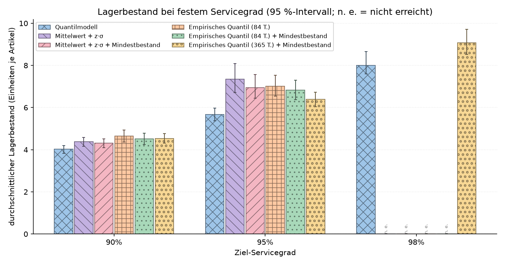

# Methodik und Details

Ergänzung zur [README](../README.md): Kennzahlen, Vorgehen im Detail, Diagnose der Baselines,
Grenzen und Hinweise zur Ausführung.

## Kennzahlen

| Begriff | Bedeutung |
|---|---|
| **Lieferzeit** | Tage zwischen Bestellung und Wareneingang (Annahme: 3 Tage). |
| **Bedarfssumme** | Summe der Nachfrage über *Lieferzeit + 1* Tage ab heute. Der Bestand muss reichen, bis die nächste Bestellung eintrifft. Das Quantilmodell sagt genau diese Größe voraus. |
| **Zielbestand (Order-up-to-Niveau)** | Soll-Bestand inklusive bereits bestellter Ware. Bestellmenge = Zielbestand minus (Lagerbestand + Ware unterwegs). Der Zielbestand ist ein Quantil der Bedarfssumme. |
| **Quantil q** | „Mit Wahrscheinlichkeit q ist die Bedarfssumme höchstens so groß.“ Ein höheres q bedeutet mehr Sicherheit und mehr Lager. |
| **Kalibrierung** | Anteil der Fälle, in denen die Nachfrage tatsächlich unter dem vorhergesagten Quantil lag. Sollte ungefähr q entsprechen. |
| **Servicegrad (Fill Rate)** | 1 minus entgangene Menge geteilt durch Gesamtnachfrage, mengengewichtet über alle Artikel. Nicht zu verwechseln mit q: q ist die Wahrscheinlichkeit, keine Fehlmenge zu haben, der Servicegrad der Anteil gelieferter Einheiten. |
| **Durchschnittlicher Lagerbestand** | Mittlerer Bestand am Tagesende in Einheiten je Artikel. Näherung für die Kapitalbindung. |
| **Fehlmenge (Lost Sales)** | Nachfrage, die nicht bedient werden konnte. Sie geht verloren und wird nicht nachgeliefert. |
| **Kostenverhältnis r** | Kosten einer nicht gelieferten Einheit (z. B. entgangener Gewinn) im Verhältnis zu den Kosten, eine Einheit einen Tag lang zu lagern. Gesamtkosten = Lager-Einheitentage + r mal Fehlmenge. Bestellkosten sind nicht modelliert. |
| **Mindestbestand** | Untergrenze für das Zielniveau (hier 1 Einheit). Verhindert, dass Artikel ohne jüngere Verkäufe dauerhaft kein Lager haben. |
| **Beste Baseline** | Die Baseline-Variante mit dem niedrigsten Lagerbestand (bzw. den niedrigsten Kosten) beim jeweiligen Ziel. Sie wird anhand derselben Testdaten gewählt. |
| **Pinball-Loss** | Verlustfunktion für Quantilprognosen: bestraft zu niedrige und zu hohe Werte asymmetrisch je nach q. Wird zum Trainieren und zum Vergleich der Quantilprognosen genutzt. |
| **WAPE** | Summe der absoluten Fehler geteilt durch die Summe der tatsächlichen Verkäufe. |
| **MASE** | Fehler im Verhältnis zum Fehler einer naiven Prognose (unter 1 ist besser als naiv). |
| **Merkmalswichtigkeit (Gain)** | Anteil, den ein Merkmal am gesamten Verbesserungsgewinn aller Baumsplits hat (Summe 100 %). Zeigt, welche Merkmale das Modell nutzt, aber keine Kausalität. Korrelierte Merkmale teilen sich die Wichtigkeit. |
| **Bootstrap-Konfidenzintervall** | Die Artikel werden mit Zurücklegen neu gezogen und die Kennzahl jeweils neu berechnet. Die mittleren 95 % der Ergebnisse bilden das Intervall. |

## Vorgehen im Detail

1. **Merkmale ohne Leakage** (`dfi/features.py`): Alle Lags und Rolling-Statistiken sind um
   mindestens den Prognosehorizont (28 Tage) verschoben. Dadurch ist keine rekursive Prognose
   nötig, und jedes Merkmal ist zum Prognosezeitpunkt bekannt. Neben Lags und kurzen
   Durchschnitten (7 und 28 Tage) gibt es Langfristmerkmale über 91, 182 und 364 Tage
   (Durchschnitt, Anteil der Tage ohne Verkauf, Streuung; Konfiguration `forecast.long_windows`).
2. **Quantilmodelle** (`dfi/models.py`): Gradient Boosting (LightGBM) je Quantil, nicht kreuzend.
   Das Modell für die Bestandsentscheidung sagt die Bedarfssumme über Lieferzeit + 1 Tage direkt
   voraus. Das Trainingsfenster endet so, dass kein Zielfenster in den Testzeitraum reicht.
   Zusätzlich gibt es tägliche Quantilmodelle, die nur der Genauigkeitsmessung (WAPE) dienen.
3. **Baselines** (`dfi/inventory.py`, Konfiguration `inventory.baselines`):
   - `baseline_mean_z`: Mittelwert der letzten 28 Tage plus z mal Standardabweichung.
   - `baseline_empirical_q_<Tage>`: empirisches Quantil der rollierenden Bedarfssummen im
     Rückblick von 84 bzw. 365 Tagen.
   - Varianten mit Mindestbestand (`_floor`): Zielniveau mindestens 1 Einheit.
4. **Bestandssimulation** (`dfi/inventory.py`): Order-up-to-Politik mit täglicher Disposition und
   Lieferzeit. Jede Politik wird über einen Parameterbereich (z bzw. q) simuliert.
5. **Vergleich:** Statt einzelner Punkte werden (a) die Kompromisskurven, (b) der Lagerbestand bei
   festem Servicegrad (lineare Interpolation, keine Extrapolation) und (c) die minimalen
   Gesamtkosten je Kostenverhältnis verglichen. Jede Politik darf ihren Parameter für jedes Ziel
   neu wählen. Das Modell wird mit der jeweils besten Baseline verglichen.
6. **Validierung** (`dfi/evaluate.py`): rollierende Cutoffs (Standard: 3 Fenster zu je 28 Tagen),
   Neutraining je Fenster, Ergebnisse über die Fenster zusammengefasst.
7. **Unsicherheit** (`dfi/bootstrap.py`): 95-%-Intervalle per Bootstrap über die Artikel, gepaart
   über alle Politiken.

## Weitere Ergebnisse des Hauptlaufs

- **Gesamtkosten** gegen die beste Baseline: r = 5: −2,0 % [−2,9 %, −0,9 %]; r = 10: −1,3 %
  [−2,5 %, −0,4 %]; r = 20: −5,8 % [−6,8 %, −4,6 %]; r = 50: −8,4 % [−10,3 %, −6,6 %];
  r = 100: −8,6 % [−10,8 %, −6,1 %].
- **Pinball-Loss** bei q ab 0,99: 11 bis 42 % besser. Die empirische Baseline ist dort
  strukturell schwach (wenige Fenster), deshalb zählt dieser Wert nicht zur Kernaussage.
- **WAPE** der täglichen Prognose gegen den gleitenden Durchschnitt: 7,3 % besser
  [6,6 %, 8,0 %]. Der gleitende Durchschnitt ist eine schwache Referenz.
- **Stabilität:** Bei 95 % Servicegrad liegt das Modell in allen drei Fenstern vorn (etwa −14 %,
  −12 % und −8 % gegenüber der jeweils besten Baseline).
- **Wirkung der Langfristmerkmale:** Ohne sie war gegenüber der besten Baseline kein belastbarer
  Unterschied erkennbar. Mit ihnen sank der Lagerbestand bei 95 % Servicegrad von 6,42 auf 5,67
  Einheiten je Artikel. Die Streuung über 91 Tage und der Durchschnitt über 364 Tage tragen
  zusammen gut ein Fünftel der Gain-Wichtigkeit.

## Diagnose der Baselines

Artikel ohne Verkauf im Rückblick haben bei Baselines ohne Mindestbestand das Zielniveau 0
(8,0 % der Artikel bei 28 Tagen, 3,3 % bei 84 Tagen, 0,2 % bei 365 Tagen). Das erklärt nur einen
Teil der Lücke: Die Baselines mit 84 Tagen Rückblick erreichen höchstens etwa 97 % Servicegrad,
die mit 365 Tagen und Mindestbestand etwa 99,5 %, das Modell etwa 99,8 %.

Das empirische Quantil kann nie über die größte Bedarfssumme im Rückblick steigen. Seine Kurve
endet deshalb früh. „Mittelwert + z · σ“ ist nach oben offen, hilft aber nicht bei Artikeln ohne
Verkäufe im Rückblick. Der Vorsprung des Modells bei sehr hohen Servicegraden liegt also zum Teil
an dieser Konstruktion der Baselines.

## Annahmen und Grenzen

- Lieferzeit und Bestellpolitik sind vereinfachte Annahmen. Nicht gedeckte Nachfrage geht
  verloren, es gibt keine Mindestbestellmengen und keine Bestellkosten.
- Die Simulation zeigt Tendenzen unter diesen Annahmen, keine garantierten Einsparungen.
- **Intervalle:** Sie erfassen nur die Unsicherheit der Artikelauswahl. Die Testfenster des
  Hauptlaufs decken etwa drei Monate aus einer Jahreszeit ab, liegen direkt hintereinander und
  sind nicht unabhängig.
- **Entwicklung auf den Testfenstern:** Die Langfristmerkmale wurden eingeführt, nachdem die
  Ergebnisse gegen die starken Baselines bekannt waren. Die Bestätigungsläufe zeigen den
  Vorsprung auch auf anderen Filialen und Zeiträumen, aber kleiner.
- **Bestätigung nicht vollständig unabhängig:** Alle Filialen verkaufen dasselbe Sortiment, CA_2
  und TX_1 laufen im selben Zeitraum wie der Hauptlauf, und der Lauf über zehn Monate enthält das
  letzte Fenster des Hauptlaufs.
- **Asymmetrie zugunsten der Baselines:** Die Merkmale des Modells sind mindestens 28 Tage alt,
  die Baselines nutzen die Daten bis unmittelbar zum Cutoff.
- Die beste Baseline wird auf den Testdaten gewählt. Das ist optimistisch für die Baselines und
  konservativ für das Modell.
- **Fehlerband an den Rändern:** Dort erreichen weniger Bootstrap-Ziehungen den jeweiligen
  Servicegrad. Mit niedriger Schwelle (`evaluation.band_min_valid`) wird das Band vollständig
  gezeichnet, stützt sich an den Rändern aber auf weniger Ziehungen und kann verzerrt sein.

## Ausführung

- **Bestätigungsläufe:** `python scripts/run_confirmation.py` rechnet alle fehlenden Läufe aus
  `configs/confirmation.yaml` und fasst sie zusammen. `--only CA_2` wählt einzelne Läufe,
  `--force` rechnet alles neu. Jeder Lauf schreibt Tabellen, Abbildungen und `run_info.json` in
  seinen Ausgabeordner.
- **Speicherbedarf:** Der Lauf mit allen Artikeln einer Filiale (etwa 3.000 Serien und 3,7 Mio.
  Zeilen) braucht viel Arbeitsspeicher. Meldet das Betriebssystem `Killed`, war der Speicher voll.
  Abhilfe: `--max-series 1500`, `--n-splits 2` oder weniger `n_estimators`.
- **Baselines der täglichen Prognose:** `python scripts/run_baselines.py` wertet Seasonal Naive
  und den gleitenden Durchschnitt mit WAPE und MASE aus.

## Abbildungen eines Laufs

`scripts/train_forecast.py` schreibt nach `results/figures/`:

| Datei | Inhalt |
|---|---|
| `inventory_tradeoff.png` | Kompromisskurven Servicegrad gegen Lagerbestand mit Fehlerband für das Modell und die beste Baseline |
| `inventory_at_service_level.png` | Lagerbestand bei festem Servicegrad mit 95-%-Intervall |
| `cost_sensitivity.png` | Relative Kostendifferenz je Kostenverhältnis |
| `pinball_improvement.png` | Pinball-Verbesserung der Bedarfssumme je Quantil |
| `feature_importance.png` | Merkmalswichtigkeit (Gain) der Bedarfssummen-Modelle |
| `feature_importance_daily.png` | Dasselbe für die täglichen Quantilmodelle |
| `stability_splits.png` | Lagerbestand bei 95 % Servicegrad je Fenster |
| `wape.png` | WAPE der täglichen Prognose |
| `bootstrap_histograms.png` | Bootstrap-Verteilungen der wichtigsten Differenzen |

`scripts/summarize_runs.py` schreibt zusätzlich `results/confirmation/confirmation_forest.png`.

## Mögliche nächste Schritte

- Tagesaktuelle Disposition mit kurzen Lags und täglich neuer Prognose
- Auswertung getrennt nach Schnell- und Langsamdrehern
- Kategorien für Artikel, Filiale und Abteilung statt Zahlencodes
- Bestellkosten und Mindestbestellmengen in der Simulation
